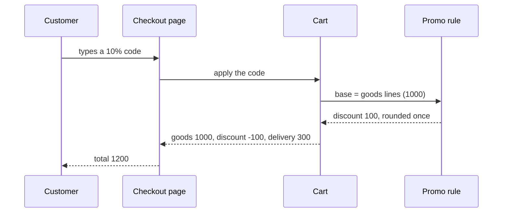

# Walkthrough — a promo code stops applying to the delivery fee
[COVERS] = 3f1a2b4..4e5f6a7

**Stage:** Execute · **Date:** 2026-11-07 · **Branch:** `fix/promo-delivery`

| Repository | Range | Commits | ± lines |
|---|---|---|---|
| `shop` | `3f1a2b4..4e5f6a7` | 4 | +649/−64 |

The statement is in Task.md. The verdicts are in Validation.md, Review.md and Done.md.

> **How to read.** The gist is in What changed and Summary; they take five minutes. Unfamiliar words are in Glossary.
> Each commit section opens with one sentence on what it did, then the failure, the fix and how it was verified.

## What changed

A customer sees two differences, both at checkout. Nothing changes for an order placed without a promo code.

### 1. A promo code no longer takes anything off the delivery fee

| | |
|---|---|
| **Before:** | Goods for 1000, delivery for 300, a 10% code. The code came off all 1300, so the customer paid 1170. |
| **After:** | The code comes off the goods alone: 100 off 1000. Delivery stays 300, and the same order costs 1200. |
| **Commits:** | 1, 2 |

### 2. Checkout shows delivery on its own line, after the discount

| | |
|---|---|
| **Before:** | The summary had three lines: order 1300, discount −130, total 1170. Delivery was hidden inside the first one. |
| **After:** | Four lines: goods 1000, promo code −100, delivery 300, total 1200. The customer can check that 100 is 10% of 1000. |
| **Commits:** | 1, 3 |

## Glossary

What the checkout summary looks like after the task, and which part each word below names:

```
 Goods              1000   <- goods lines, the discount base
 Promo code 10%     -100   <- taken from the base only
 Delivery            300   <- the delivery line, never discounted
 --------------------------
 Total              1200
```

**Cart line (`CartLine`)** — one row of the cart: a product, the delivery, or a service fee such as gift wrapping. Before this task, all three looked the same to the code that applies a discount.

**Line kind (`LineKind`)** — what a cart line is: goods, delivery or fee. It is new here, and every later commit reads it.

**Discount base** — the sum a promo code is taken from. It used to be the whole cart. Now it is the goods lines only.

**Promo code** — a code the customer types at checkout. It is either a percentage (10% off) or a fixed amount (500 off). A fixed amount never takes the base below zero.

**Saved cart** — a cart the shop keeps between visits, for up to thirty days. Carts saved before this task have no line kinds, which is where commit 1 gets its trouble.

**Rounding** — prices are whole units. A discount is rounded down once, after it is computed, so the customer never pays a fraction.

## Summary

**Why.** The promo terms say a code is taken off the goods. Two things depend on that:

- the delivery partner is paid the full fee, so every discounted delivery cost the shop money it never offered;
- customers compared the discount with the goods and asked support why a 10% code took off 130.

**What was done.**

| # | Part | In plain words |
|---|---|---|
| 1 | Line kinds | Every cart line says whether it is goods, delivery or a fee |
| 2 | Discount base | A promo code is taken from the goods lines only |
| 3 | Checkout summary | Delivery is shown on its own line, after the discount |

**Main decisions.**

1. The kind is stored on the line, not looked up in the catalogue. A product removed from the catalogue would leave its line without a kind, and the cart could not be totalled.
2. The discount is rounded once, on the whole base, not line by line. Rounding down drops a fraction on every line, so a ten-line cart could get nine units less than promised.
3. Delivery gets a line of its own, not a footnote saying it is not discounted. A footnote tells the customer the rule but not the number to check it against.

## Commit order

| Commit | Needs | Why here |
|---|---|---|
| 1. Line kinds | — | Every later commit reads the kind of a line |
| 2. Discount base | 1 | The base is the sum of the lines whose kind is goods |
| 3. Checkout summary | 1, 2 | It shows the delivery line and the discount computed from the base |

The kind comes first because it is the only thing the other two share. Without it, the discount and the summary would each guess which line is delivery, and could guess differently.

## Plan vs. outcome

| Planned | Landed | Why | Trigger |
|---|---|---|---|
| Delivery found by the name of its line | A kind stored on every line | The name differs in each storefront language | implementation |
| Discount rounded per line | Rounded once, on the base | A ten-line cart got up to nine units less discount | Review |

## Commits

### 1. `3f1a2b4` — every cart line says what it is

`feat(cart): store the kind of every cart line`

**Files:** `LineKind` (+38), `CartLine` (+22/−4), `SavedCartUpgrade` (+71), tests (+164).

**Changes:** 1, 2.

**In short:** every cart line now carries its kind, so later code can tell delivery from goods without guessing.

#### What appeared

- **A kind on each line:** goods, delivery or fee, set when the line is added to the cart.
- **An upgrade for old carts:** a cart saved before this commit gets its kinds once, the first time it is opened (`SavedCartUpgrade`).

#### What failure this is written against

1. A customer fills a cart today and comes back tomorrow, after the release.
2. The saved cart has no kinds, because it was written before they existed.
3. If a missing kind counted as goods, the delivery line would join the discount base.
4. The customer would pay 1170 instead of 1200 for exactly the carts saved before the release.

#### How it is closed

- A line without a kind is never totalled; the upgrade gives it one first.
- The upgrade marks the line of the delivery product as delivery, a known fee as fee, and everything else as goods.

**How verified:** a test opens a cart saved in the old format and expects one delivery line and two goods lines. With the upgrade switched off on purpose, that test and two others went red.

#### Why the kind is stored and not looked up in the catalogue

The catalogue already knows which product is delivery, so a lookup looked cheaper. But a product can leave the catalogue while it sits in a saved cart. Its line would then have no kind, and the whole cart would fail to total.

### 2. `5d6e7f8` — a promo code is taken from the goods alone

`fix(cart): take the promo discount from the goods lines only`

**Files:** `DiscountBase` (+54), `PromoRule` (+31/−27), tests (+142).

**Changes:** 1.

**In short:** the discount is now computed from the goods lines and rounded once, so delivery is always paid in full.

#### What failure this is written against

| What could break | What it would look like |
|---|---|
| The code still reaches delivery | A 10% code on 1000 of goods and 300 of delivery takes off 130, and the customer pays 1170 |
| A fixed code exceeds the goods | A 500 code on 400 of goods eats into delivery, and an order costs 200 instead of 300 |
| Rounding per line | Three goods of 335 each lose half a unit apiece, and a 10% code takes off 99 instead of 100 |

#### How it is closed

- The base is the sum of the goods lines; delivery and fees are added after the discount.
- A fixed code is capped at the base, so the goods can go to zero but never below.
- The discount is rounded down once, on the whole base.

The cases the tests hold, for the hardest of the three rules:

| Cart | Code | Should cost | Cost before |
|---|---|---|---|
| goods 1000, delivery 300 | 10% | 1200 | 1170 |
| goods 400, delivery 300 | 500 off | 300 | 200 |
| goods 3 × 335, delivery 300 | 10% | 1205 | 1175 |

**How verified:** each row of the table above is a test. With delivery put back into the base on purpose, four tests went red.

#### Why the base is built and not the delivery added back

The obvious patch was to keep the old discount and return 10% of the delivery afterwards. That works for a percentage only. A fixed code has no share of the delivery to return, so the second row of the table would stay wrong.

### 3. `9a0b1c2` — checkout shows what the code was taken from

`feat(checkout): show delivery as its own line below the discount`

**Files:** `CheckoutSummary` (+48/−30), tests (+76).

**Changes:** 2.

**In short:** the checkout summary lists goods, discount, delivery and total, so the customer can check the discount by eye.

#### What failure this is written against

1. After commit 2 alone, the summary still showed order 1300, discount −100 and total 1200.
2. A customer divides 100 by 1300 and gets less than 8%.
3. The customer decides the 10% code is broken and writes to support, or leaves the cart.

#### How it is closed

- The summary shows the goods line first, then the discount, then delivery, then the total.
- A cart with no promo code shows no discount line, and nothing else moves.

**How verified:** a test builds the summary of the 1000 and 300 cart and expects four lines in that order. With delivery merged back into the first line on purpose, two tests went red.

#### Why a line and not a footnote

A footnote saying "delivery is not discounted" states the rule. It does not show the number the rule was applied to, and that number is what the customer checks.

### Bookkeeping

- `4e5f6a7` — plan checkboxes ticked for the three phases (+3/−3).

## How it works

One action crosses four parts: the customer types a code, and the summary comes back.



## Out of scope

- Codes that make delivery free on purpose. They need a kind of rule of their own, and the marketing team owns that task.
- Stacking two codes on one order. The shop allows one code per order today, and this task kept it so.

## Follow-ups

- Refunds still recompute the discount the old way for orders placed before the release. The refund task carries the fix.
