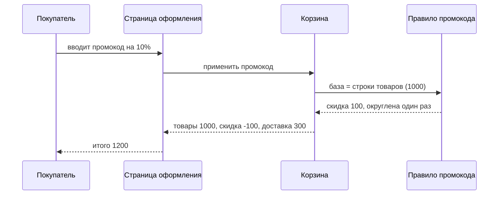

# Walkthrough — промокод перестаёт действовать на доставку
[COVERS] = 3f1a2b4..4e5f6a7

**Stage:** Execute · **Date:** 2026-11-07 · **Branch:** `fix/promo-delivery`

| Repository | Range | Commits | ± lines |
|---|---|---|---|
| `shop` | `3f1a2b4..4e5f6a7` | 4 | +649/−64 |

Постановка — в Task.md. Вердикты — в Validation.md, Review.md и Done.md.

> **How to read.** Суть — в разделах «What changed» и «Summary», на них уйдёт пять минут. Незнакомые слова — в «Glossary».
> Раздел каждого коммита открывается одной фразой о том, что он сделал, затем сбой, решение и как это проверено.

## What changed

Покупатель видит два отличия, оба при оформлении заказа. Для заказа без промокода ничего не меняется.

### 1. Промокод больше ничего не снимает с доставки

| | |
|---|---|
| **Before:** | Товары на 1000, доставка 300, промокод на 10%. Скидка снималась со всех 1300, и покупатель платил 1170. |
| **After:** | Скидка снимается только с товаров: 100 с 1000. Доставка остаётся 300, и тот же заказ стоит 1200. |
| **Commits:** | 1, 2 |

### 2. При оформлении доставка показана отдельной строкой, после скидки

| | |
|---|---|
| **Before:** | В итогах было три строки: заказ 1300, скидка −130, итого 1170. Доставка пряталась в первой строке. |
| **After:** | Четыре строки: товары 1000, промокод −100, доставка 300, итого 1200. Покупатель может сам проверить, что 100 — это 10% от 1000. |
| **Commits:** | 1, 3 |

## Glossary

Так выглядят итоги заказа после задачи, и вот какую их часть называет каждое слово ниже:

```
 Товары             1000   <- строки товаров, база скидки
 Промокод 10%       -100   <- снимается только с базы
 Доставка            300   <- строка доставки, скидка на неё не действует
 --------------------------
 Итого              1200
```

**Строка корзины (`CartLine`)** — одна позиция корзины: товар, доставка или сбор, например за подарочную упаковку. До этой задачи код, который применяет скидку, не отличал их друг от друга.

**Вид строки (`LineKind`)** — чем является строка корзины: товаром, доставкой или сбором. Он появился в этой задаче, и его читает каждый следующий коммит.

**База скидки** — сумма, с которой снимается промокод. Раньше это была вся корзина. Теперь — только строки товаров.

**Промокод** — код, который покупатель вводит при оформлении. Он бывает процентным (минус 10%) или на сумму (минус 500). Промокод на сумму никогда не уводит базу ниже нуля.

**Сохранённая корзина** — корзина, которую магазин хранит между визитами, до тридцати дней. У корзин, сохранённых до этой задачи, нет видов строк, и отсюда трудность коммита 1.

**Округление** — цены в целых единицах. Скидка округляется вниз один раз, после расчёта, поэтому покупатель никогда не платит дробную сумму.

## Summary

**Why.** По условиям акции промокод снимается с товаров. От этого зависят две вещи:

- партнёр по доставке получает полную стоимость, поэтому каждая доставка со скидкой стоила магазину денег, которых он не обещал;
- покупатели сравнивали скидку с товарами и спрашивали поддержку, почему промокод на 10% снял 130.

**What was done.**

| # | Part | In plain words |
|---|---|---|
| 1 | Виды строк | Каждая строка корзины знает, товар она, доставка или сбор |
| 2 | База скидки | Промокод снимается только со строк товаров |
| 3 | Итоги заказа | Доставка показана отдельной строкой, после скидки |

**Main decisions.**

1. Вид хранится в строке, а не ищется в каталоге. Товар, убранный из каталога, оставил бы свою строку без вида, и корзину нельзя было бы посчитать.
2. Скидка округляется один раз, на всю базу, а не по строкам. Округление вниз теряет дробь на каждой строке, и корзина из десяти строк недополучила бы до девяти единиц.
3. У доставки своя строка, а не сноска о том, что скидка на неё не действует. Сноска сообщает правило, но не даёт числа, по которому его проверить.

## Commit order

| Commit | Needs | Why here |
|---|---|---|
| 1. Виды строк | — | Каждый следующий коммит читает вид строки |
| 2. База скидки | 1 | База — это сумма строк, у которых вид «товар» |
| 3. Итоги заказа | 1, 2 | Показывают строку доставки и скидку, посчитанную от базы |

Вид идёт первым, потому что это единственное, что нужно обоим другим коммитам. Без него скидка и итоги каждые по-своему угадывали бы строку доставки и могли бы угадать по-разному.

## Plan vs. outcome

| Planned | Landed | Why | Trigger |
|---|---|---|---|
| Доставку узнаём по названию строки | Вид хранится в каждой строке | На каждом языке витрины название своё | implementation |
| Скидка округляется по строкам | Один раз, на всю базу | Корзина из десяти строк недополучала до девяти единиц скидки | Review |

## Commits

### 1. `3f1a2b4` — каждая строка корзины знает, что она такое

`feat(cart): store the kind of every cart line`

**Files:** `LineKind` (+38), `CartLine` (+22/−4), `SavedCartUpgrade` (+71), тесты (+164).

**Changes:** 1, 2.

**In short:** у каждой строки корзины теперь есть вид, и следующий код отличает доставку от товаров, ничего не угадывая.

#### What appeared

- **Вид у каждой строки:** товар, доставка или сбор; задаётся, когда строку кладут в корзину.
- **Обновление старых корзин:** корзина, сохранённая до этого коммита, получает виды один раз, при первом открытии (`SavedCartUpgrade`).

#### What failure this is written against

1. Покупатель собирает корзину сегодня и возвращается завтра, уже после выпуска.
2. В сохранённой корзине нет видов: её записали раньше, чем они появились.
3. Если бы строка без вида считалась товаром, строка доставки попала бы в базу скидки.
4. Покупатель заплатил бы 1170 вместо 1200 — ровно в тех корзинах, что сохранены до выпуска.

#### How it is closed

- Строку без вида никогда не считают; сначала обновление даёт ей вид.
- Обновление помечает строку товара-доставки как доставку, известный сбор как сбор, а всё остальное как товары.

**How verified:** тест открывает корзину, сохранённую в старом формате, и ждёт одну строку доставки и две строки товаров. Когда обновление нарочно отключили, упали этот тест и ещё два.

#### Why the kind is stored and not looked up in the catalogue

Каталог и так знает, какой товар — доставка, поэтому поиск в нём казался дешевле. Но товар может уйти из каталога, пока лежит в сохранённой корзине. Тогда у его строки не будет вида, и вся корзина не посчитается.

### 2. `5d6e7f8` — промокод снимается только с товаров

`fix(cart): take the promo discount from the goods lines only`

**Files:** `DiscountBase` (+54), `PromoRule` (+31/−27), тесты (+142).

**Changes:** 1.

**In short:** скидка теперь считается от строк товаров и округляется один раз, поэтому доставка всегда оплачивается полностью.

#### What failure this is written against

| What could break | What it would look like |
|---|---|
| Промокод по-прежнему задевает доставку | Промокод на 10% к товарам на 1000 и доставке 300 снимает 130, и покупатель платит 1170 |
| Промокод на сумму больше товаров | Промокод на 500 к товарам на 400 съедает часть доставки, и заказ стоит 200 вместо 300 |
| Округление по строкам | Три товара по 335 теряют по половине единицы, и промокод на 10% снимает 99 вместо 100 |

#### How it is closed

- База — сумма строк товаров; доставка и сборы прибавляются после скидки.
- Промокод на сумму ограничен базой: товары могут дойти до нуля, но не ниже.
- Скидка округляется вниз один раз, на всю базу.

Случаи, которые держат тесты, для самого трудного из трёх правил:

| Корзина | Промокод | Должно стоить | Стоило раньше |
|---|---|---|---|
| товары 1000, доставка 300 | 10% | 1200 | 1170 |
| товары 400, доставка 300 | минус 500 | 300 | 200 |
| товары 3 × 335, доставка 300 | 10% | 1205 | 1175 |

**How verified:** каждая строка таблицы выше — отдельный тест. Когда доставку нарочно вернули в базу, упали четыре теста.

#### Why the base is built and not the delivery added back

Очевидная заплатка — оставить старую скидку и потом вернуть 10% от доставки. Это работает только для процентного промокода. У промокода на сумму нет доли доставки, которую можно вернуть, и вторая строка таблицы осталась бы неверной.

### 3. `9a0b1c2` — итоги заказа показывают, с чего снята скидка

`feat(checkout): show delivery as its own line below the discount`

**Files:** `CheckoutSummary` (+48/−30), тесты (+76).

**Changes:** 2.

**In short:** итоги заказа перечисляют товары, скидку, доставку и сумму, и покупатель может проверить скидку на глаз.

#### What failure this is written against

1. После одного коммита 2 итоги всё ещё показывали заказ 1300, скидку −100 и итого 1200.
2. Покупатель делит 100 на 1300 и получает меньше 8%.
3. Он решает, что промокод на 10% сломан, и пишет в поддержку или бросает корзину.

#### How it is closed

- Итоги показывают сначала строку товаров, затем скидку, затем доставку, затем сумму.
- В корзине без промокода строки скидки нет, и больше ничего не сдвигается.

**How verified:** тест собирает итоги корзины на 1000 и 300 и ждёт четыре строки в этом порядке. Когда доставку нарочно слили обратно с первой строкой, упали два теста.

#### Why a line and not a footnote

Сноска «скидка на доставку не действует» сообщает правило. Она не показывает число, к которому правило применили, а проверяет покупатель именно его.

### Bookkeeping

- `4e5f6a7` — отмечены пункты плана для трёх фаз (+3/−3).

## How it works

Одно действие проходит через четыре части: покупатель вводит промокод и получает итоги.



## Out of scope

- Промокоды, которые нарочно делают доставку бесплатной. Им нужно своё правило, и эта задача у команды маркетинга.
- Два промокода на один заказ. Сейчас магазин принимает один промокод на заказ, и задача это сохранила.

## Follow-ups

- Возвраты для заказов, оформленных до выпуска, всё ещё пересчитывают скидку по-старому. Исправление несёт задача о возвратах.
